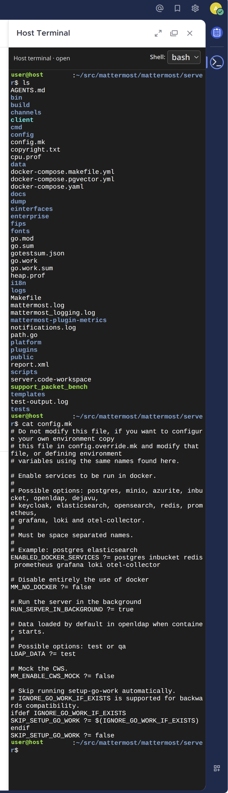
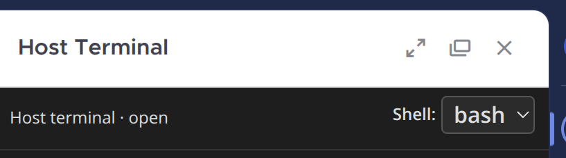
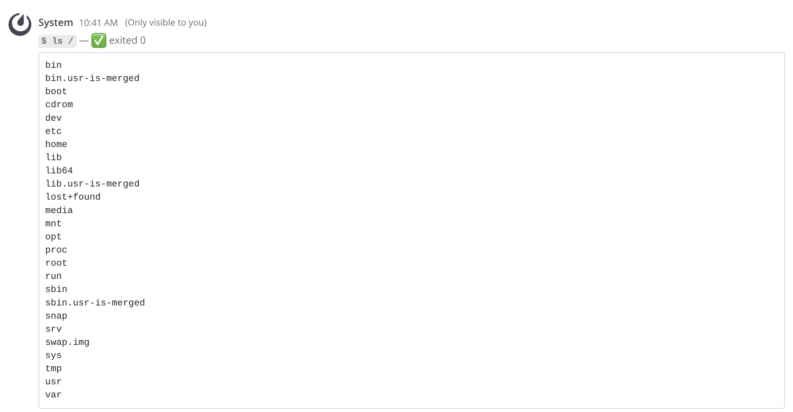
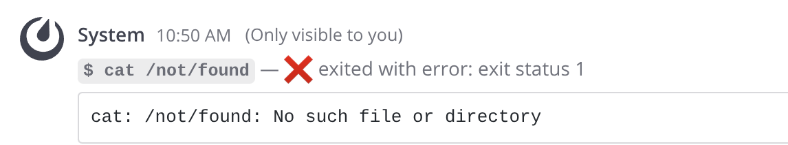
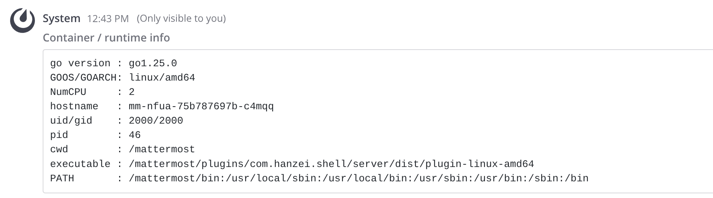
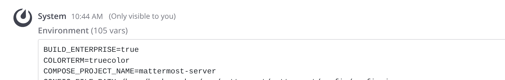
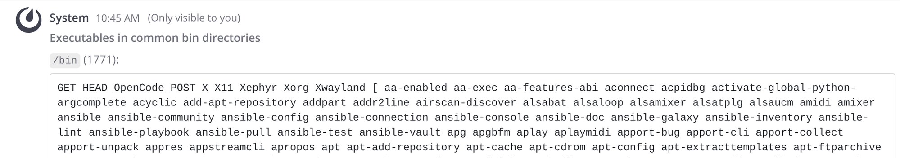
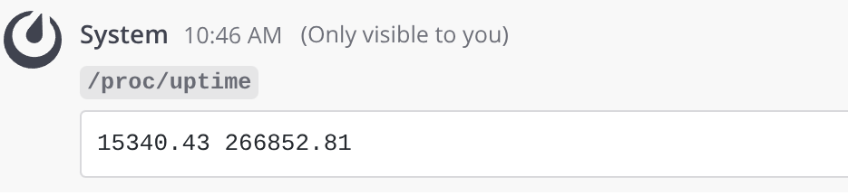

# Shell

> ⚠️ **DANGER — DO NOT USE IN PRODUCTION** ⚠️
>
> This plugin puts an **interactive shell on the host machine** running the
> Mattermost server, reachable from chat — plus `/exec` and `/inspect` commands
> for one-off use. Although everything is restricted to system administrators, it
> effectively grants a remote shell on your server and has **no sandboxing, no
> audit trail, and no resource limits**. It is an experiment intended for labs and
> pre-prod environments only. Never deploy it to production or an internet-facing
> environment.

A Mattermost plugin that gives system admins an interactive shell on the host —
as a right-hand-sidebar terminal, plus `/exec` and `/inspect` slash commands.

## Interactive terminal

The marquee feature: a full interactive terminal in the right-hand sidebar.
Click the terminal button in the channel header to open it.



- Spawns an interactive shell with a PTY on the host, as the Mattermost server
  process user.
- **Per-user shell selection:** a dropdown in the panel header lists the shells
  detected on the host (`bash`, `zsh`, `fish`, `sh`, `dash`, `ksh`, `tcsh`). The
  choice is saved per user and reused on the next open. The
  detected set is also the allowlist — a requested shell that isn't detected is
  ignored and the default (bash, then sh) is used, so no client-supplied path is
  ever executed.

  
- A generated rc file enables a colored prompt, `ls`/`grep` color aliases,
  dircolors, and bash programmable completion for `bash` (via `--rcfile`) and
  POSIX shells (via `$ENV`). Other shells (`zsh`, `fish`, `tcsh`) run
  interactively and use the host user's own dotfiles.
- Transport is a WebSocket through the plugin's HTTP path
  (`/plugins/com.hanzei.shell/api/v1/terminal`), using the framework's
  connection-hijack support. Output is streamed as binary frames; keystrokes and
  resize events are sent as JSON control messages.
- Live sessions are tracked and killed when the plugin is deactivated.

### High-availability clusters

In a cluster, a **Node** dropdown appears next to the shell picker, listing the
connected nodes from `/api/v4/cluster/status`. The first node is selected by
default; after that, the panel opens on the node you picked last (remembered
per browser, by node ID and, since IDs change when a node restarts, by host
name).

The browser's WebSocket lands on whichever node the load balancer picks (the
*edge*), and the shell runs on the chosen node (the *target*). The two exchange keystrokes and output over plugin cluster
events addressed to one node (`PublishPluginClusterEvent` with a `TargetId`), so
nothing is broadcast to the rest of the cluster and no extra network access
between nodes is needed. Messages carry sequence numbers so order is restored
whatever the cluster transport guarantees. The target node re-checks that the
user is a system admin before it starts a shell.

The plugin API can't tell a node its own cluster ID yet, so the webapp sends
the node list with the request and the edge finds itself in it: first by its
gossip address (local interface IP plus `ClusterSettings.GossipPort`), then by
the advertised name (host name, IP or `OverrideHostname`). If nothing matches,
or several nodes do, the request fails with an error.

Both sides of a session ping each other every 10 seconds. If one side hears
nothing for 30 seconds, or can't reach the other node at all, it ends the
session: the browser shows "node … stopped responding" and the shell is killed
on its node. So a node that crashes or drops out of the cluster leaves neither
a hung terminal nor a stray shell.

Known limit: `/exec` and `/inspect` still run on whichever node receives the
command.

## Slash commands

For one-off use without opening the terminal. Both are restricted to **system
administrators** and run as the OS user of the Mattermost server process.

`/exec <command>` runs the command on the host via `sh -c` and returns the
combined stdout/stderr as an ephemeral message.

```
/exec uname -a
/exec df -h | grep /dev/sda1
```



The status line reflects the command's exit code, so failures are obvious:



`/inspect [info|env|bins|cat <path>]` introspects the host/container using pure
Go — no shell spawned — so it works even in shell-less images (distroless,
scratch). `info` reports runtime/OS facts, `env` the environment, `bins` the
executables in common bin directories, and `cat` reads a file (e.g.
`/etc/os-release`).



`/inspect env` shows the process environment:



`/inspect bins` lists the executables found in common bin directories:



`/inspect cat <path>` reads a file directly — handy where no shell or `cat`
binary exists:



## Development

Requires Go and Node (see `.nvmrc`; run `nvm i` to match).

Build the plugin bundle:

```
make
```

This produces `dist/com.hanzei.shell-<version>.tar.gz`.

### Deploying to a local server

Enable [local mode](https://docs.mattermost.com/administration/mmctl-cli-tool.html#local-mode)
in your server config, then:

```
make deploy
```

```json
{
    "ServiceSettings": {
        "EnableLocalMode": true,
        "LocalModeSocketLocation": "/var/tmp/mattermost_local.socket"
    }
}
```

Alternatively, deploy by authenticating against the server API:

```bash
export MM_SERVICESETTINGS_SITEURL=http://localhost:8065
export MM_ADMIN_USERNAME=admin
export MM_ADMIN_PASSWORD=password
make deploy
```

To learn more about plugins, see the
[Mattermost plugin documentation](https://developers.mattermost.com/extend/plugins/).
